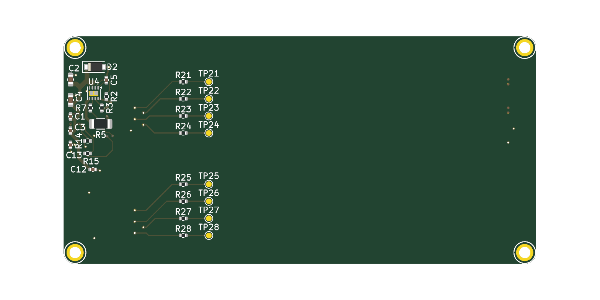
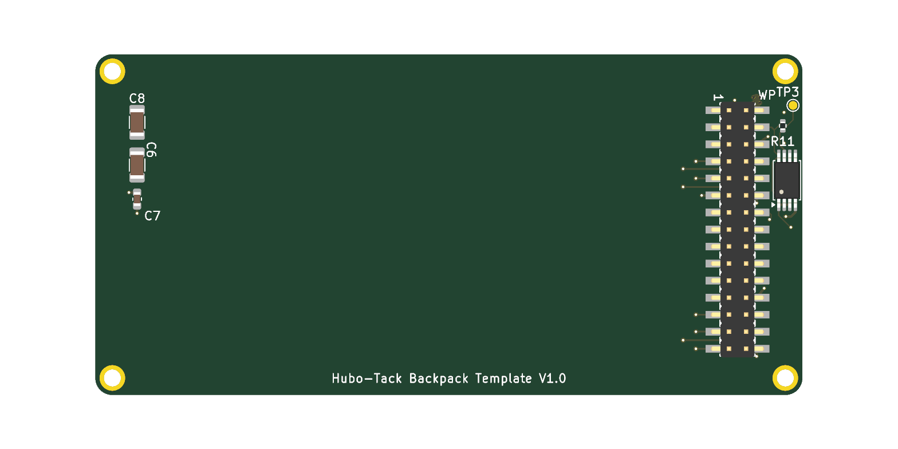

English | [简体中文](./README.zh-CN.md)

# Hubo-Tack 30-pin backpack template

A blank KiCad 10 project for a backpack board that plugs into the Hubo-Tack 30-pin connector.
The outline, mounting holes, header, ID card and 5 V input protection are already done and pass
ERC, DRC and the backpack check — you only add your own circuit.

| Top | Bottom |
|---|---|
|  |  |

The easiest way to use it is through the AI skill in
[hubo-backpack-skill](https://github.com/hubosmart/hubo-backpack-skill), which ships a copy of this
template and walks an agent through the design and checks. The interface rules are in
[hubo-backpack-spec](https://github.com/hubosmart/hubo-backpack-spec).

## What is already on the board

| Block | Parts | Why |
|---|---|---|
| 30-pin header (bottom) | H1 | Position, pad numbers and nets follow the spec; pads 16/19/20/21/22/26 are left open |
| Outline and holes | SCREW1–4 | 83.0 × 40.0 mm, R2 corners, four M2 holes at (±39.5, ±18.0) mm, tied to GND |
| 5 V input protection | D2, U4 (TPS259533 eFuse, ≈2.04 A limit), C1–C5, C12, R2, R3, R7 | The backpack protects itself; eFuse fault (FLT) goes to `ESP_INT` through R7 |
| Protected 5 V for you | R5 (0 Ω), C6–C8, inner layer PWR | `5V_USER` is a full plane on the PWR layer — take power from it anywhere |
| ID card, programmed type | U1 (AT24C02 at I²C 0x57), R11 + TP3 (WP), R14/R15 (100 Ω), C13 | DIY boards must program a descriptor, see below |
| Reuse-area series resistors | R21–R28 (0402, 0 Ω) + TP21–TP28 | One per reuse pad, near the header, as the spec requires |

Reuse pads and their nets:

| Header pad | 7 | 8 | 9 | 10 | 25 | 27 | 28 | 29 |
|---|---|---|---|---|---|---|---|---|
| Series resistor | R21 | R22 | R23 | R24 | R25 | R26 | R27 | R28 |
| Your side (net / test point) | USR_P7 / TP21 | USR_P8 / TP22 | USR_P9 / TP23 | USR_P10 / TP24 | USR_P25 / TP25 | USR_P27 / TP26 | USR_P28 / TP27 | USR_P29 / TP28 |

What each reuse pad means depends on the `form_id` in your ID card. For the definition of every pin and the interface figure, see ["30-pin interface at a glance" on the hubo-backpack-spec front page](https://github.com/hubosmart/hubo-backpack-spec#30-pin-interface-at-a-glance).

## What you may change

- Everything you add on the top side, powered from `5V_USER`, connected to `USR_P*`, `ID_SCL`/`ID_SDA`
  (other I²C devices must avoid 0x50–0x57) and `ESP_INT`.
- C6–C8 values, to suit your load.
- Remove TP21–TP28 if you don't need them. They are only debug test points; their position says nothing about where
  connectors belong.
- Place parts per SPEC-003 2.11–2.14: external connectors (USB-C, HDMI, RJ45, SMA, buttons and the like) on the right
  edge, opposite the header, none on the header side; connectors for cables that stay inside the enclosure (FPC, U.FL)
  on the top edge.

## What you must not change

- Outline, hole positions, header position and its pad nets.
- The ID card address (0x57), the WP pull-up R11 and test point TP3.
- Do not power heavy loads from `3V3` (≤ 50 mA in total); use `5V_USER`, 5 V total ≤ 2 A.

R5 reaches the `5V_USER` plane through two vias. If your load is close to 2 A, add vias next to R5.

## Programming the ID card (required for DIY)

1. Pick a `product_id` from the DIY range `0xF000`–`0xFFFE` (no need to ask anyone).
2. Generate the 16-byte image with the skill's tool:
   `python idcard_image.py --form-id 0 --product-id 0xF001 --hw-ver 0x10 -o idcard.bin`
3. Pull TP3 (WP) low and write the image to the AT24C02 at I²C address 0x57, offset 0x00, with any I²C
   EEPROM programmer.

## Checks

- ERC 0, DRC 0 (all severities, with schematic parity), backpack check: no FAIL.
- Checks switched off in the project settings (cosmetic or not applicable to this template):
  ERC — global label only appears once, four connection points joined, SPICE model issue,
  footprint filter mismatch; DRC — footprint has no courtyard, track endpoint not centered on via,
  tuning profile track geometries, footprint does not match symbol filters, footprint type does not
  match pads. Turn them back on if your design needs them.
- Passing the checks does not mean the board is ready to order. **The last check must be a human.**

## License

CERN-OHL-P v2, see [LICENSE](LICENSE). The footprints and symbols in `kicad/lib/` are part of this
project. All 3D models are referenced from the KiCad libraries (`${KICAD10_3DMODEL_DIR}`) and are not
distributed here; they keep their own license (CC-BY-SA 4.0 with the KiCad library exception).
