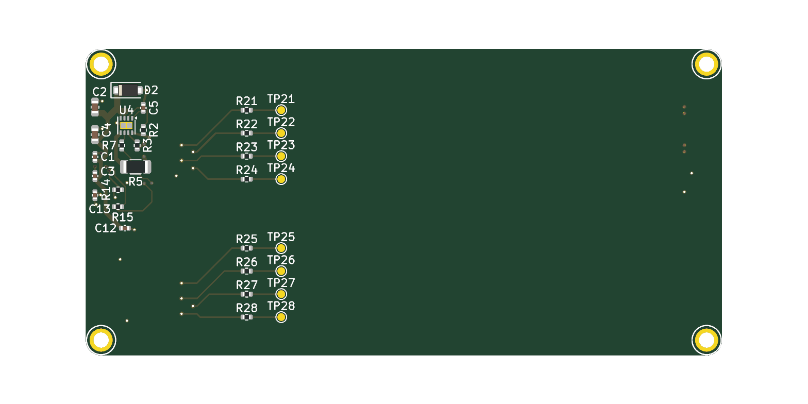
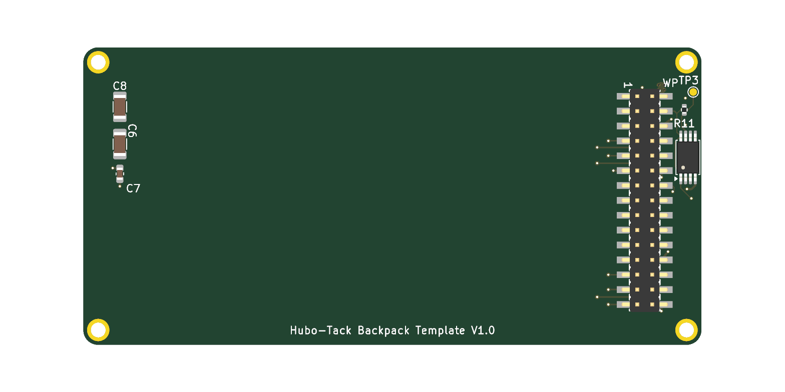

[English](./README.md) | 简体中文

# Hubo-Tack 30-Pin 背包空白模板

插在 Hubo-Tack 30-Pin 连接座上的背包板的 KiCad 10 空白工程。板框、安装孔、排针、身份卡、5V 入口保护
都已画好，并通过 ERC、DRC 与背包规范检查——你只需要加自己的电路。

| 顶面 | 底面 |
|---|---|
|  |  |

最省事的用法是配合 AI 技能 [hubo-backpack-skill](https://github.com/hubosmart/hubo-backpack-skill)：
它内置本模板的副本，带着 AI 按步骤画板和检查。接口规范见
[hubo-backpack-spec](https://github.com/hubosmart/hubo-backpack-spec)。

## 板上已有的电路

| 功能块 | 位号 | 为什么 |
|---|---|---|
| 30-Pin 排针（底面） | H1 | 位置、焊盘号、网络按规范；焊盘 16、19、20、21、22、26 默认悬空 |
| 板框与安装孔 | SCREW1～4 | 83.0 × 40.0 mm、四角 R2，四个 M2 孔在 (±39.5, ±18.0) mm，接 GND |
| 5V 入口保护 | D2、U4（TPS259533 电子保险丝，限流约 2.04 A）、C1～C5、C12、R2、R3、R7 | 背包自带保护；保险丝故障信号 FLT 经 R7 接 `ESP_INT` |
| 给你用的受保护 5V | R5（0 Ω）、C6～C8、内层 PWR | `5V_USER` 是 PWR 层整层铺铜，板上任何位置打孔取电 |
| 身份卡（烧录版） | U1（AT24C02，I²C 0x57）、R11 + TP3（WP）、R14/R15（100 Ω）、C13 | DIY 背包必须烧写描述符，见下文 |
| 复用区串阻 | R21～R28（0402、0 Ω）+ TP21～TP28 | 每个复用焊盘一颗，靠近排针，规范要求 |

复用焊盘与网络对应：

| 排针焊盘 | 7 | 8 | 9 | 10 | 25 | 27 | 28 | 29 |
|---|---|---|---|---|---|---|---|---|
| 串阻 | R21 | R22 | R23 | R24 | R25 | R26 | R27 | R28 |
| 你这一侧（网络／测试点） | USR_P7 / TP21 | USR_P8 / TP22 | USR_P9 / TP23 | USR_P10 / TP24 | USR_P25 / TP25 | USR_P27 / TP26 | USR_P28 / TP27 | USR_P29 / TP28 |

每个复用焊盘的含义取决于身份卡里的 `form_id`。30-Pin 每一针的定义与接口图见 [hubo-backpack-spec 首页的“30-Pin 接口一览”](https://github.com/hubosmart/hubo-backpack-spec/blob/main/README.zh-CN.md#30-pin-接口一览)。

## 可以改的

- 顶面加的一切电路：从 `5V_USER` 取电，接 `USR_P*`、`ID_SCL`/`ID_SDA`（其他 I²C 器件须避开 0x50～0x57）、`ESP_INT`。
- C6～C8 的容值，按你的负载调整。
- 用不到的 TP21～TP28 可以删。它们只是调试测试点，所在位置不代表接口该放哪。
- 摆放位置按规范 SPEC-003 2.11～2.14：对外插拔接口（USB-C、HDMI、RJ45、SMA、按键等）放右板边（排针对侧），排针一侧不放；只在外壳内走线的座子（FPC、U.FL）放上板边。

## 不能改的

- 板框、孔位、排针位置与焊盘网络。
- 身份卡地址（0x57）、WP 上拉 R11 与测试点 TP3。
- 大电流负载不要接 `3V3`（合计 ≤ 50 mA），一律从 `5V_USER` 取电，5V 合计 ≤ 2 A。

R5 到 `5V_USER` 平面有两个过孔；负载接近 2 A 时，在 R5 旁补过孔。

## 烧写身份卡（DIY 必做）

1. 在 DIY 号段 `0xF000`～`0xFFFE` 里自选一个 `product_id`（无需申请）。
2. 用技能里的工具生成 16 字节镜像：
   `python idcard_image.py --form-id 0 --product-id 0xF001 --hw-ver 0x10 -o idcard.bin`
3. 把 TP3（WP）拉低，用任意 I²C EEPROM 烧录器把镜像写到 I²C 地址 0x57 的 AT24C02、偏移 0x00。

## 检查

- ERC 0、DRC 0（全部级别，含原理图一致性），背包规范检查无 FAIL。
- 工程设置里关掉的检查项（外观类或对本模板不适用）：ERC——全局标签只出现一次、四线交汇、SPICE 模型、封装过滤器不匹配；DRC——封装无 courtyard、过孔上走线端点未居中、调谐走线几何、封装与符号过滤器不匹配、封装类型与焊盘不符。你的设计需要时请重新打开。
- 检查通过不代表可以直接下单。**最后一关必须是人。**

## 许可证

CERN-OHL-P v2，见 [LICENSE](LICENSE)。`kicad/lib/` 里的封装与符号属本项目。3D 模型全部引用 KiCad 官方库（`${KICAD10_3DMODEL_DIR}`），不随本仓库分发，沿用其自身许可（CC-BY-SA 4.0 附 KiCad 库例外条款）。
